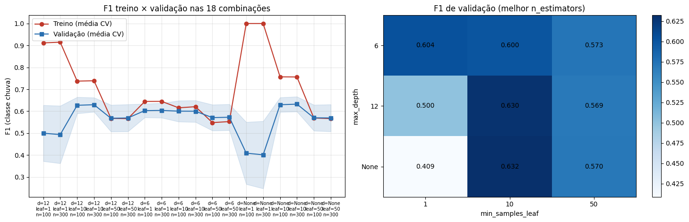
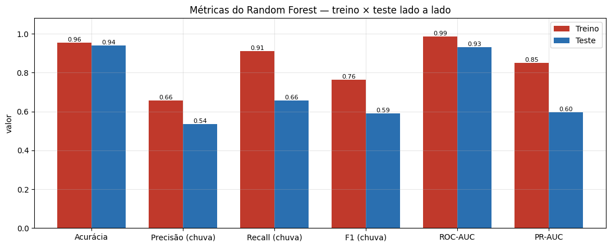

# Relatório de Machine Learning — Vai chover na próxima hora em São Paulo?

**CitizenTech · FIAP 2026 · Inteligência Artificial & Machine Learning**
Albert Katri (RM556544) · Bruno Biletsky (RM554739) · Paulo Akira (RM556840)
Notebook: [`ml/projeto_chuva_sp.ipynb`](ml/projeto_chuva_sp.ipynb) · Dados: [`ml/dados/README.md`](ml/dados/README.md)

## 1. Problema e dados reais

Chuvas repentinas em São Paulo causam alagamentos, trânsito e atrasos no transporte, e pegam o cidadão desprevenido. A CitizenTech quer um **aviso de curtíssimo prazo** para ajudar a decidir se a pessoa sai agora, leva guarda-chuva ou espera.

**Pergunta de ML (classificação binária):** *com as medições da estação oficial do INMET na hora atual, é possível prever se vai chover na próxima hora?* O alvo `chuva_prox_hora` vale 1 quando a precipitação da hora seguinte é > 0 mm (resolução do pluviômetro: 0,2 mm).

| Item | Valor |
|---|---|
| Fonte | INMET — Dados Históricos Anuais, estação automática **A701 São Paulo/Mirante de Santana** |
| Link | https://portal.inmet.gov.br/dadoshistoricos (arquivos `2023.zip`, `2024.zip`, `2025.zip`) |
| Período | 01/01/2023 a 31/12/2025, horário — 26.304 registros |
| Variáveis | precipitação, pressão, radiação global, temperatura, ponto de orvalho, umidade, direção/velocidade/rajada do vento |

Os CSVs oficiais estão versionados sem alteração em `ml/dados/brutos/`. **Nenhum dado simulado foi usado.** A chuva ocorre em apenas 7,4 % das horas e se concentra no verão (jan: 13,5 %) e entre 15 h e 18 h (≈ 11 %).

## 2. Modelo escolhido: Random Forest

| Critério do problema | Por que Random Forest |
|---|---|
| Interações não lineares (umidade alta **e** pressão caindo **e** fim de tarde) | Árvores combinam condições sem engenharia manual |
| Escalas muito diferentes (hPa, %, kJ/m², m/s) | Não exige normalização |
| Classe rara (7,4 %) | `class_weight="balanced"` |
| Risco de overfitting | Controlável por `max_depth`, `min_samples_leaf` e média de muitas árvores |
| Explicação para gestor/cidadão | Importância das variáveis |

Regressão Logística é linear demais para essas interações; Naive Bayes supõe independência entre variáveis muito correlacionadas (temperatura, orvalho, umidade); MLP/LSTM exigem mais dados e são pouco interpretáveis; K-means não é supervisionado. Como referência, comparamos o modelo com a regra de **persistência** (“se chove agora, chove na próxima hora”) e com “nunca chove”.

## 3. Preparação e divisão treino/teste

1. Leitura dos CSVs brutos (Latin-1, `;`, decimal `,`), conversão de UTC para horário de Brasília e grade horária completa (0 duplicatas, 0 horas ausentes).
2. `-9999` → faltante. Faltantes: precipitação 2,7 %, demais sensores ≈ 1,1 %, radiação 46,8 % (vazia à noite → 0). Checagem de faixas físicas (nenhum valor fora).
3. Falhas de até 2 h nas variáveis contínuas preenchidas com o **último valor válido** (só passado). **A precipitação nunca é imputada.** Linhas incompletas removidas → 25.024 horas (95,1 %).
4. 21 atributos, todos com informação de `t` ou anterior: chuva atual, da hora anterior e acumulada em 3 h e 6 h; tendência de pressão em 3 h; variação de umidade e temperatura em 1 h; déficit de orvalho; vento (direção em seno/cosseno); hora e mês em seno/cosseno.
5. **Divisão temporal, sem embaralhar:** treino = 2023–2024 (16.507 h, 7,9 % com chuva); teste = 2025 inteiro (8.517 h, 6,5 % com chuva). O teste cobre todas as estações e só é usado uma vez, no final.

## 4. Treino com diferentes hiperparâmetros

`GridSearchCV` com **18 combinações de 3 hiperparâmetros** — `n_estimators` {100, 300} × `max_depth` {6, 12, None} × `min_samples_leaf` {1, 10, 50} — e `TimeSeriesSplit` (5 dobras) **somente no treino** (90 ajustes). Métrica de seleção: F1 da classe chuva (equilibra alarmes falsos e chuvas perdidas); também foram registrados PR-AUC e ROC-AUC.

| max_depth | min_samples_leaf | n_estimators | F1 treino (CV) | F1 validação (CV) | Gap |
|---|---|---|---|---|---|
| **None** | **10** | **300** | **0,756** | **0,632 ± 0,034** | 0,124 |
| 12 | 10 | 300 | 0,739 | 0,630 | 0,109 |
| 6 | 1 | 300 | 0,645 | 0,604 | 0,041 |
| None | 50 | 100 | 0,569 | 0,570 | −0,001 |
| 12 | 1 | 100 | 0,912 | 0,500 | 0,412 |
| None | 1 | 300 | 1,000 | 0,401 | 0,599 |

A curva mostra os dois extremos: árvores livres com folhas de 1 amostra **decoram o treino** (F1 = 1,00) e validam mal (0,40) — overfitting forte; folhas de 50 amostras eliminam o gap, mas perdem desempenho (*underfitting*). O ponto ótimo foi `min_samples_leaf=10`.

## 5. Resultados em treino e teste

| Métrica | Treino (2023–24) | Teste (2025) | Diferença |
|---|---|---|---|
| Acurácia | 0,955 | 0,941 | 0,015 |
| Precisão (chuva) | 0,656 | 0,535 | 0,121 |
| Recall (chuva) | 0,909 | 0,656 | 0,253 |
| F1 (chuva) | 0,762 | 0,590 | 0,173 |
| ROC-AUC | 0,986 | 0,931 | 0,055 |
| PR-AUC | 0,850 | 0,596 | 0,253 |

**Overfitting:** existe e é **moderado** — F1 cai de 0,76 para 0,59 e o recall de 0,91 para 0,66. Ainda assim, o F1 de teste é próximo do estimado pela validação cruzada (0,632) e o ROC-AUC de teste (0,931) ≈ validação (0,921): a validação temporal previu bem o comportamento num ano novo. Parte da queda vem de 2025 ser mais seco que o treino; o desempenho é pior em meses secos (julho: 9 h de chuva, F1 0,29). A acurácia não serve para julgar: “nunca chove” já acerta 93,5 %.

**Comparação no teste (2025):**

| Abordagem | Precisão | Recall | F1 |
|---|---|---|---|
| Nunca chove | 0,000 | 0,000 | 0,000 |
| Persistência | 0,576 | 0,575 | 0,576 |
| **Random Forest** | 0,535 | **0,656** | **0,590** |

As variáveis mais importantes foram chuva acumulada em 3 h e 6 h, chuva atual, déficit de orvalho e umidade — coerente com a meteorologia: ar perto da saturação antecede a chuva.

## 6. Conclusão para o cidadão

- Em 2025 houve 553 horas de chuva no Mirante de Santana. O modelo avisou **1 hora antes em 363 delas (65,6 %)**, contra 318 (57,5 %) da regra “se está chovendo, vai continuar”.
- O ganho principal está no **início da chuva**: em 235 horas a chuva começou com o tempo ainda seco. A persistência nunca avisa esses casos; o modelo antecipou **46 (19,6 %)** e deu, em média, probabilidade 0,33 a esses inícios contra 0,09 em horas que continuaram secas — ou seja, ele “percebe” a chuva chegando.
- **Custo:** cerca de metade dos alertas “vai chover” se confirma (precisão 0,535). Para um aviso do tipo “leve guarda-chuva / saia mais cedo / evite ponto de alagamento”, um alarme falso custa pouco e uma chuva perdida custa mais, por isso privilegiamos recall.
- **Uso:** a probabilidade vira um aviso em três níveis (baixa / moderada ≥ 0,4 / alta ≥ 0,7) em app ou painel.
- **Limites:** uma estação representa a vizinhança, não a cidade toda (chuvas de verão são muito localizadas); o modelo não prevê volume nem alagamento; o desempenho cai nos meses secos. Ele **complementa**, e não substitui, os alertas da Defesa Civil e do CGE.
- **Próximos passos:** incluir outras estações do INMET/CGE para cobrir mais bairros, prever 2–3 h à frente e ajustar o limiar de alerta com a Defesa Civil.
